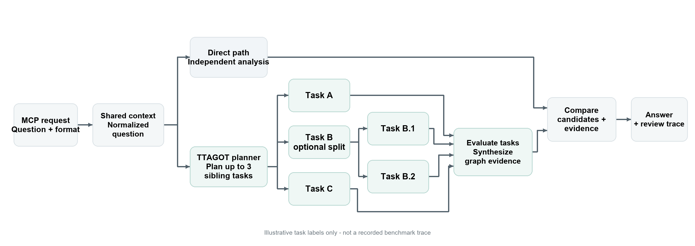
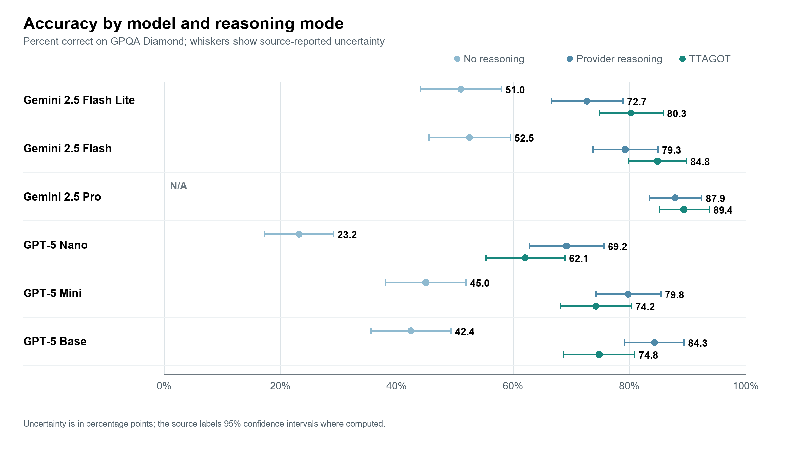

# TTAGOT | Reasoning system showcase

TTAGOT is a reasoning prototype built around the Model Context Protocol (MCP), combining structured branching, independent analysis, and evidence review for complex question answering.

## System concept

The design combines an independent direct-analysis path with a TTAGOT adaptive graph reasoning path. TTAGOT can split a problem into sibling tasks, selectively branch one task further, evaluate the branches, and synthesize their evidence. A comparison stage reviews that synthesis alongside the independent analysis.

The diagram is illustrative: task labels are examples, not a trace from a recorded benchmark question.

## Benchmark snapshot

The source study reports aggregate GPQA-Diamond results across six model configurations and 198 graduate-level STEM multiple-choice questions. For the five models with a no-reasoning baseline, TTAGOT scored 29.2–38.9 percentage points higher. Against provider reasoning, outcomes were mixed: higher on all three Gemini configurations and lower on all three GPT-5 configurations.

Each question was evaluated once per available condition. The figure shows source-reported uncertainty intervals where available; the study did not report repeated trials, hypothesis tests, or effect sizes.

See the [benchmark report (PDF)](presentations/benchmark-results.pdf) for the detailed results.

## What this work demonstrates

- Reasoning-system design: branching task structure, selective decomposition, synthesis, and comparison of independent paths.
- Evaluation and analysis: cross-model benchmark comparisons, baseline interpretation, and analysis of accuracy and uncertainty.
- Technical communication: turning an architecture and aggregate results into concise, reviewable visuals.

Source: *Advanced Reasoning MCP, Chapters 1–6*, Chapter 4, Tables 4.2–4.4.
